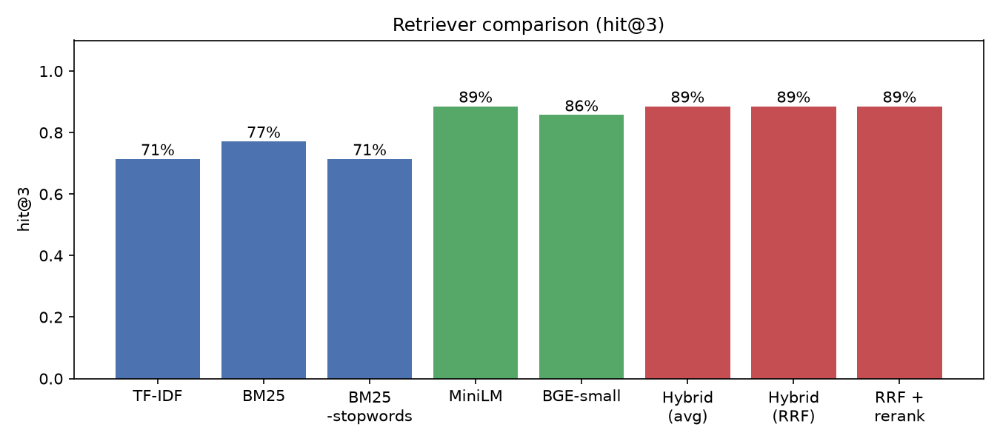

# Retrievers

Eight ways to find the sentence that answers a question, compared on the same small test set.



## The test

- **Corpus:** [`royal-family.txt`](royal-family.txt), split into **112 sentences**. Each sentence is one passage, and citation markers like `[13]` are removed first.
- **Questions:** [`retriever-question.txt`](retriever-question.txt) holds **35 questions**, one per line, in the form `question | quote`. The correct answer is the one sentence that contains the quote. Labelling by quote rather than sentence number means editing the text doesn't break the labels. If a quote matches no sentence or more than one, the script stops with an error.
- **Question mix:** about half reuse the source's words ("What is the Court Circular?"). The rest are reworded on purpose ("Who steps in if the king is too ill to do his job?" for *counsellors of state*), which tests matching on meaning rather than shared words.
- **Metric:** **hit@3**, the share of questions where the correct sentence is in the top 3 results. A retriever picking at random would score about 3%.

## Results

| Group | Retriever | hit@3 |
|---|---|---|
| Word matching | TF-IDF | 71% |
| | BM25 | 77% |
| | BM25 without common words | 71% |
| Embedding models | MiniLM | **89%** |
| | BGE-small | 86% |
| Combined | Hybrid, average of scores | **89%** |
| | Hybrid, rank fusion | **89%** |
| | Rank fusion + re-ranker | **89%** |

**What the results show:**

1. **Embedding models beat word matching by 10–18 points.** BM25 and TF-IDF fail when the question shares no words with the answer: "Where do the Prince and Princess of Wales *live*?" against an answer that says "*moved to* Forest Lodge".
2. **Word matching still wins on some questions.** Exact terms such as *counsellors of state* and *Church of Scotland* were found by BM25 but missed by both embedding models.
3. **Combining the two fixes some misses and causes others.** Both hybrids rescue some of the questions only BM25 found, lose others, and end up level with MiniLM alone. Rank fusion is the more robust of the two, because it uses rank order only, so BM25's poorly separated scores can't outweigh the embedding model.
4. **Removing common words hurt BM25** (77% → 71%). In short questions, words like "who", "no" and "live" carry meaning.
5. **Newer or larger isn't automatically better.** BGE-small is built specifically for search, but it scored slightly below MiniLM here.
6. **One question is missed by every retriever.** "Where did the habit of royals chatting with crowds outside events begin?" is answered by a sentence that only says "this tradition". The word *walkabouts* is in the sentence before it. Splitting into single sentences cut the answer off from its context.

> With 35 questions, each question is worth about 3 points, so differences of one question are noise. The 4-way tie at 89% means hit@3 can no longer separate the strongest methods.

## The retrievers

Every retriever subclasses [`Retriever`](retrievers/base.py). It implements `scores(query)`, which returns one score per passage, and inherits `retrieve(query, k)`, which returns the indices of the top `k` passages.

| File | Class | How it works |
|---|---|---|
| [`tfidf_retriever.py`](retrievers/tfidf_retriever.py) | `TfidfRetriever` | TF-IDF word vectors (scikit-learn, English common words removed) compared by cosine similarity. |
| [`bm25_retriever.py`](retrievers/bm25_retriever.py) | `BM25Retriever` | BM25Okapi from `rank_bm25`, on lowercased word tokens. `drop_stopwords=True` removes common words first. |
| [`embedding_retriever.py`](retrievers/embedding_retriever.py) | `EmbeddingRetriever` | sentence-transformers embeddings compared by cosine similarity. Defaults to `all-MiniLM-L6-v2`. `query_prefix` adds an instruction to the query only, which BGE models expect. |
| [`hybrid_retriever.py`](retrievers/hybrid_retriever.py) | `HybridRetriever` | Scales each retriever's scores to 0–1 and averages them. |
| [`rrf_retriever.py`](retrievers/rrf_retriever.py) | `RRFRetriever` | Reciprocal rank fusion: each passage scores `Σ 1 / (60 + rank)` across retrievers. Uses rank order only, never the raw scores. |
| [`rerank_retriever.py`](retrievers/rerank_retriever.py) | `RerankRetriever` | Two stages: takes the first stage's top 20, then re-scores each (question, sentence) pair with the cross-encoder `ms-marco-MiniLM-L-6-v2`. Everything outside the top 20 ranks last. |

To add a retriever, subclass `Retriever`, implement `scores`, and add it to the `retrievers` dict in [`main.py`](main.py).

## Running it

From the project root:

```bash
python -m pip install -r requirements.txt
python main.py
```

The script prints HIT or MISS for every question and retriever, then saves the chart as `hit_at_3.png` in the project root. The first run downloads about 300 MB of models from Hugging Face. After that they load from the local cache.

## Next steps

- **Report hit@1 and MRR** (how high the right answer is ranked, on average) to break the tie at 89%.
- **Split the text into 2–3-sentence chunks** so answers like the walkabout one keep their context.
- **Report scores separately for reworded and exact-wording questions**, to show where each method wins.
- **Write more questions.** 100 or more would make small differences meaningful.
