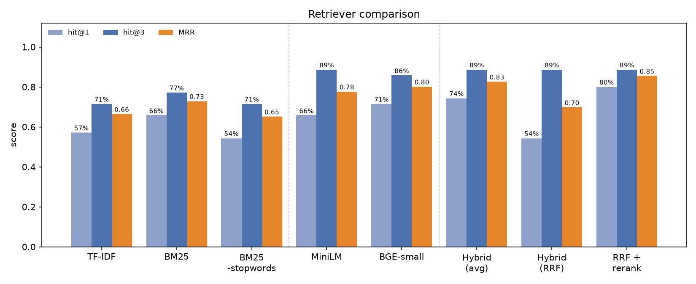

# Retrievers

Eight ways to find the sentence that answers a question, compared on the same small test set.



## The test

- **Corpus:** [`royal-family.txt`](royal-family.txt), split into **112 sentences**. Each sentence is one passage, and citation markers like `[13]` are removed first.
- **Questions:** [`retriever-question.txt`](retriever-question.txt) holds **35 questions**, one per line, in the form `question | quote`. The correct answer is the one sentence that contains the quote. Labelling by quote rather than sentence number means editing the text doesn't break the labels. If a quote matches no sentence or more than one, the script stops with an error.
- **Question mix:** about half reuse the source's words ("What is the Court Circular?"). The rest are reworded on purpose ("Who steps in if the king is too ill to do his job?" for *counsellors of state*), which tests matching on meaning rather than shared words.
- **Metrics:** each question gets the **rank** of its correct sentence in the full ranking (1 = first). A retriever picking at random would score about 3% on hit@3.
  - **hit@1:** share of questions where the correct sentence is ranked first.
  - **hit@3:** share where it is in the top 3.
  - **MRR** (mean reciprocal rank): the average of 1/rank. It is 1.0 if every answer is ranked first and 0.5 if every answer is second. It rewards a near miss more than a far one.

## Results

| Group | Retriever | hit@1 | hit@3 | MRR |
|---|---|---|---|---|
| Word matching | TF-IDF | 57% | 71% | 0.66 |
| | BM25 | 66% | 77% | 0.73 |
| | BM25 without common words | 54% | 71% | 0.65 |
| Embedding models | MiniLM | 66% | **89%** | 0.78 |
| | BGE-small | 71% | 86% | 0.80 |
| Combined | Hybrid, average of scores | 74% | **89%** | 0.83 |
| | Hybrid, rank fusion | 54% | **89%** | 0.70 |
| | Rank fusion + re-ranker | **80%** | **89%** | **0.85** |

**What the results show:**

1. **hit@1 and MRR break the 4-way tie at 89% hit@3.** The re-ranker puts the right sentence first most often (80% hit@1, MRR 0.85). Rank fusion on its own puts it first least often (54%). Top-3 coverage alone hid this gap of 9 questions.
2. **The re-ranker's job is ordering.** It only re-scores rank fusion's top 20, so it can't find anything rank fusion missed: hit@3 stays at 89%. But hit@1 rises from 54% to 80%, because a model that reads the question and sentence together sorts that shortlist much better.
3. **Rank fusion finds the answer but blurs the order.** With the standard setting (k = 60), first and second place score almost the same (1/61 vs 1/62). So when BM25 and MiniLM disagree, the right sentence often lands 2nd or 3rd instead of 1st. Averaging the scores keeps information about how confident each method is, and gets 74% hit@1. Part of the gap also comes from inputs: rank fusion here uses the weaker BM25 without common words.
4. **Embedding models beat word matching on top-3 coverage, but not always on the first result.** MiniLM and BM25 both get 66% hit@1. Where BM25 succeeds it tends to rank the answer first, and where it fails it misses completely: "Where do the Prince and Princess of Wales *live*?" against an answer that says "*moved to* Forest Lodge". MiniLM more often has the answer at 2nd or 3rd.
5. **BGE-small ranks better than MiniLM even though its hit@3 is lower** (71% vs 66% hit@1, MRR 0.80 vs 0.78). When it finds the answer, it puts it first more often.
6. **Removing common words hurt BM25 on every metric** (hit@1 66% → 54%). In short questions, words like "who", "no" and "live" carry meaning.
7. **One question is missed by every retriever.** "Where did the habit of royals chatting with crowds outside events begin?" is answered by a sentence that only says "this tradition". The word *walkabouts* is in the sentence before it. Splitting into single sentences cut the answer off from its context.

> With 35 questions, each question is worth about 3 points on hit@1 and hit@3, so a difference of one question is noise. Gaps like 54% vs 80% are not.

## The retrievers

Every retriever subclasses [`Retriever`](retrievers/base.py). It implements `scores(query)`, which returns one score per passage, and inherits `retrieve(query, k)`, which returns the indices of the top `k` passages.

| File | Class | How it works |
|---|---|---|
| [`tfidf_retriever.py`](retrievers/tfidf_retriever.py) | `TfidfRetriever` | TF-IDF word vectors (scikit-learn, English common words removed) compared by cosine similarity. |
| [`bm25_retriever.py`](retrievers/bm25_retriever.py) | `BM25Retriever` | BM25Okapi from `rank_bm25`, on lowercased word tokens. `drop_stopwords=True` removes common words first. |
| [`embedding_retriever.py`](retrievers/embedding_retriever.py) | `EmbeddingRetriever` | sentence-transformers embeddings compared by cosine similarity. Defaults to `all-MiniLM-L6-v2`. `query_prefix` adds an instruction to the query only, which BGE models expect. |
| [`hybrid_retriever.py`](retrievers/hybrid_retriever.py) | `HybridRetriever` | Scales each retriever's scores to 0–1 and averages them. |
| [`rrf_retriever.py`](retrievers/rrf_retriever.py) | `RRFRetriever` | Reciprocal rank fusion: each passage scores `Σ 1 / (60 + rank)` across retrievers. Uses rank order only, never the raw scores. |
| [`rerank_retriever.py`](retrievers/rerank_retriever.py) | `RerankRetriever` | Two stages: takes the first stage's top 20, then re-scores each (question, sentence) pair with the cross-encoder `ms-marco-MiniLM-L-6-v2`. Everything outside the top 20 ranks last. |

To add a retriever, subclass `Retriever`, implement `scores`, and add it to the `retrievers` dict in [`main.py`](main.py).

## Running it

From the project root:

```bash
python -m pip install -r requirements.txt
python main.py
```

The script prints the rank of the correct sentence for every question and retriever, plus hit@1, hit@3 and MRR per retriever. It then saves the chart as `retriever_scores.png` in the project root. The first run downloads about 300 MB of models from Hugging Face. After that they load from the local cache.

## Next steps

- **Split the text into 2–3-sentence chunks** so answers like the walkabout one keep their context.
- **Report scores separately for reworded and exact-wording questions**, to show where each method wins.
- **Write more questions.** 100 or more would make small differences meaningful.
